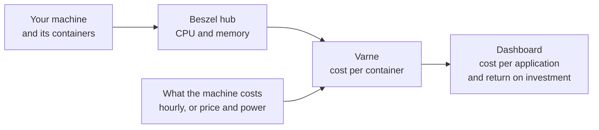

**See what every container on your machines costs, which applications they are, and what self-hosting saves you.**

You tell Varne what a machine costs and connect a [Beszel](https://beszel.dev) hub. Varne splits the cost across your Docker containers, recognises the applications, and compares them with the subscriptions they replace.

<Info>
  This page documents **Varne v1**. If you run Varne 0.x, read the [Varne v0 documentation](https://www.narev.ai/docs/varne/v0/index) instead. The two versions use different configuration, images, and screens.
</Info>

## Get started

<CardGroup cols={2}>
  <Card title="Quickstart" icon="rocket" href="/oss/varne/getting-started/quickstart">
    Run Varne, connect Beszel, and see what your containers cost in a few minutes.
  </Card>
  <Card title="Docker source" icon="docker" href="/oss/varne/sources/docker">
    How the cost of a machine is built and split across its containers.
  </Card>
</CardGroup>

## What Varne does

<CardGroup cols={2}>
  <Card title="Cost per container" icon="server" href="/oss/varne/sources/docker">
    Describe a server by its hourly rate, or by its price, lifetime, and power use. What no container used is charged to **Idle**.
  </Card>
  <Card title="Self-hosting return" icon="piggy-bank" href="/oss/varne/self-hosted/index">
    Varne recognises the applications behind your containers and compares their cost with the subscriptions they replace.
  </Card>
  <Card title="Usage from Beszel" icon="gauge" href="/oss/varne/sources/beszel">
    Container CPU and memory come from your own Beszel hub. Varne only reads from it.
  </Card>
  <Card title="Yours to keep" icon="lock" href="/oss/varne/getting-started/deployment">
    Everything Varne pulls is stored in one DuckDB file on your own machine, next to your configuration.
  </Card>
</CardGroup>

## How it works

<Steps>
  <Step title="Configure">
    List your stacks and sources in `config/varne.yaml`, or fill in the form on **Integrations**.
  </Step>
  <Step title="Sync">
    On **Integrations**, sync a source. Varne reads the container usage from Beszel and turns it into cost per container.
  </Step>
  <Step title="Read">
    The **Dashboard** shows the cost per application and compares your machines with the subscriptions they replace.
  </Step>
</Steps>

A **stack** groups the sources of one product or one place. A **source** is one connection, such as a Docker host. Billing sources such as Vercel, Anthropic, OpenAI, and Umami are in development. See [Sources](/oss/varne/sources/index).

## Keep exploring

<CardGroup cols={3}>
  <Card title="Configuration" icon="gear" href="/oss/varne/configuration/index">
    The YAML file and the form on **Integrations**.
  </Card>
  <Card title="Deploy with Docker" icon="cube" href="/oss/varne/getting-started/deployment">
    Volumes, environment variables, and keeping Varne private.
  </Card>
  <Card title="Troubleshooting" icon="life-ring" href="/oss/varne/troubleshooting">
    Fixes for the problems people meet first.
  </Card>
</CardGroup>

Varne is licensed under the [GNU Affero General Public License v3.0](https://github.com/narevai/varne/blob/main/LICENSE). The source is on [GitHub](https://github.com/narevai/varne).
