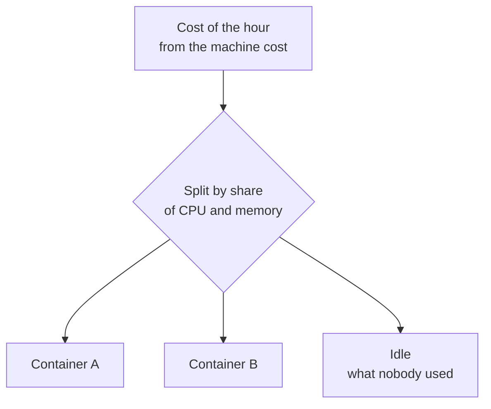

The Docker source answers: **what does each container on my machine cost me?** You tell Varne what the machine costs. Varne reads how much of it every container used, and divides the cost accordingly.

It has two parts:

- **`cost`** says what the machine costs per hour.
- **`usage`** says where Varne reads container usage from. Today that is [Beszel](https://beszel.dev), and the part is built so that other backends can follow.

## What you need

- A running **Beszel hub** with an agent on each machine you want to cover. Beszel monitors the machine and its Docker containers.
- A Beszel user: the **email** and **password** Varne uses to read the hub.

See [Connect Beszel](/oss/varne/sources/beszel) for how to point Varne at the hub and check the connection.

## Add the source

<Tabs>
  <Tab title="Own hardware">
    ```yaml
    - id: homelab
      name: Homelab
      type: docker
      cost:
        machine_cost: 1200          # USD you paid
        amortization_years: 6       # default 6
        power_draw_watts: 40        # optional, with the price below
        electricity_price_per_kwh: 0.2
      usage:
        type: beszel
        url: http://beszel:8090
        email: you@example.com
        password_env: BESZEL_PASSWORD
    ```
  </Tab>
  <Tab title="Rented machine">
    ```yaml
    - id: vps
      name: VPS
      type: docker
      cost:
        hourly_cost: 0.05           # USD per hour
      usage:
        type: beszel
        url: https://beszel.example.com
        email: you@example.com
        password_env: BESZEL_PASSWORD
    ```
  </Tab>
</Tabs>

On **Integrations**, the **Form** tab has a switch between **Rented, per hour** and **Own hardware** that shows the matching fields. All fields are in the [reference](/oss/varne/configuration/reference#docker).

## How the machine cost is built

Varne adds up lines, each worth some USD per hour.

| Line | Formula |
| --- | --- |
| **Hosting** (rented) | `hourly_cost` |
| **Hardware amortization** | `machine_cost ÷ (amortization_years × 8760 hours)` |
| **Electricity** | `power_draw_watts ÷ 1000 × electricity_price_per_kwh` |

For the example above, the hardware costs 1200 ÷ (6 × 8760) = $0.0228 per hour, and 40 W at $0.2 per kWh adds $0.008 per hour. Together that is about $0.031 per hour, or about $22.50 per month.

Costs are in USD.

## How the cost is split

Varne works hour by hour, on the hours that have passed.



1. For every container, Varne asks how much of the machine it used in that hour: its CPU, and its memory.
2. A container's **share of the hour** is half its CPU use as a part of the machine's CPU, plus half its memory use as a part of the machine's memory. If several machines are monitored, their capacities are added up.
3. The container is charged that share of the hour's cost.
4. What no container used is charged to **Idle**. The charges of an hour always add up to the cost of the machine.

An hour without data about the machine's capacity is charged entirely to **Idle**. The hour in progress counts only for the part that has passed.

Each container is stored with the machine it ran on and its image name. That image name is how Varne recognises the application. See [Self-hosted costs](/oss/varne/self-hosted/index).

## What you see

- On the **Dashboard**, the cost of each application, the return on your machine, and charts of **cost per application** and **idle capacity** per day. See [Self-hosted costs](/oss/varne/self-hosted/index).

## Things to know

- The split is an estimate based on what Beszel reports. It treats a container's CPU as a part of the whole machine.
- Containers that belong to the same application, such as a database next to a web app, appear as separate containers. Varne cannot see which containers form a stack, and groups them only when their image names point to the same application.
- The more of the lookback period Beszel has data for, the better the split. A hub that was down leaves gaps, which count as **Idle**.

## Troubleshooting

Connection errors, and what they mean, are listed in [Connect Beszel](/oss/varne/sources/beszel#check-the-connection).
